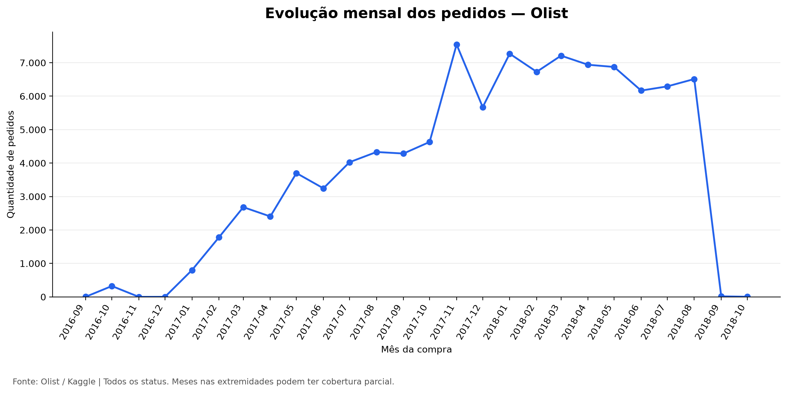
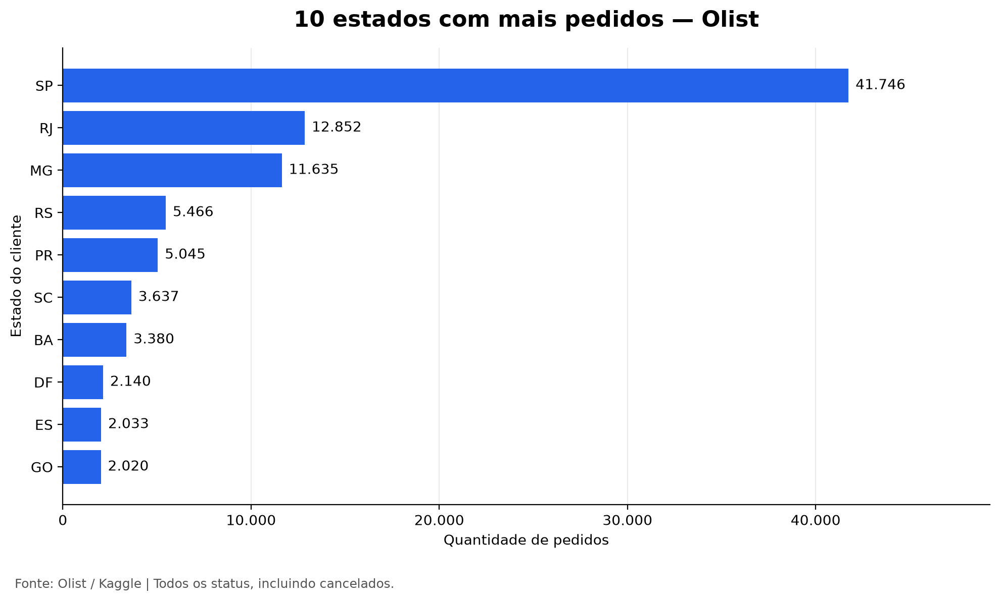
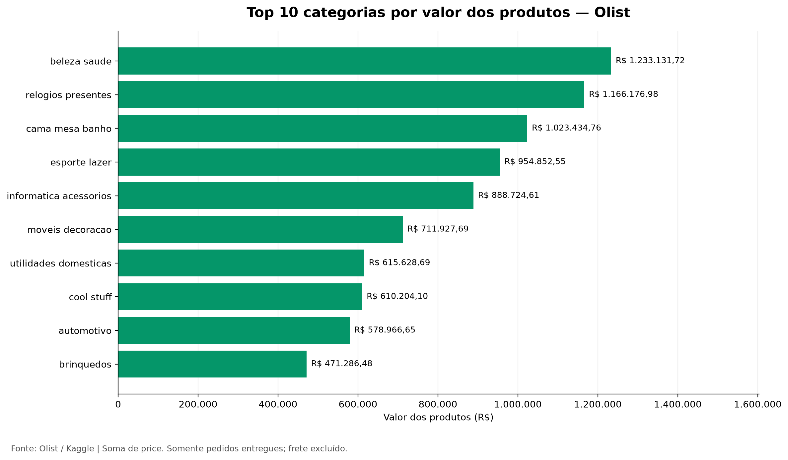
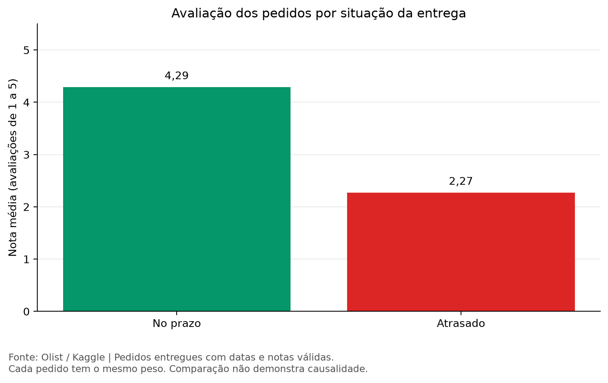

# Análise de vendas e entregas da Olist

Projeto de estudo com Python, pandas e matplotlib, utilizando 99.441 pedidos para analisar vendas, estados, categorias e avaliações.

## Resultados

- Novembro de 2017 teve o maior volume: **7.544 pedidos**.
- São Paulo concentrou **42% dos pedidos**.
- Produtos de pedidos entregues somaram **R$ 13,22 milhões**, sem frete.
- **Beleza e saúde** liderou em valor de produtos vendidos.
- **6,77%** das entregas com datas disponíveis chegaram atrasadas.
- A nota média foi **4,29** para entregas no prazo e **2,27** para atrasadas.

## Gráficos






## Como executar

Baixe a [base da Olist no Kaggle](https://www.kaggle.com/datasets/olistbr/brazilian-ecommerce) e extraia os CSVs na pasta `dados`.

No terminal da pasta do projeto, execute:

```bash
python -m pip install -r requirements.txt
python analise.py
```

As tabelas e os gráficos serão salvos em `resultados`.

## Observações

As contagens incluem todos os status; os valores por categoria consideram apenas pedidos entregues, sem frete. A análise de atrasos utiliza datas disponíveis e a comparação de notas considera avaliações válidas, com peso igual por pedido.

Os dados são históricos, de 2016 a 2018, e podem ter cobertura parcial nas extremidades da série. A relação entre atrasos e notas não comprova causalidade.

Projeto desenvolvido para praticar análise de dados, com apoio de IA na construção do código.

**Autora: Isabella Passos**